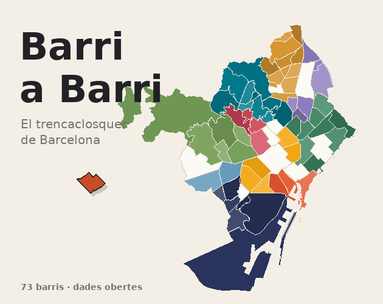
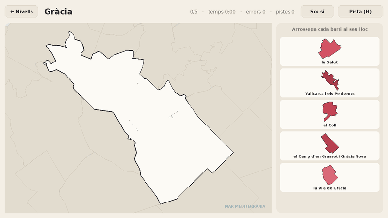
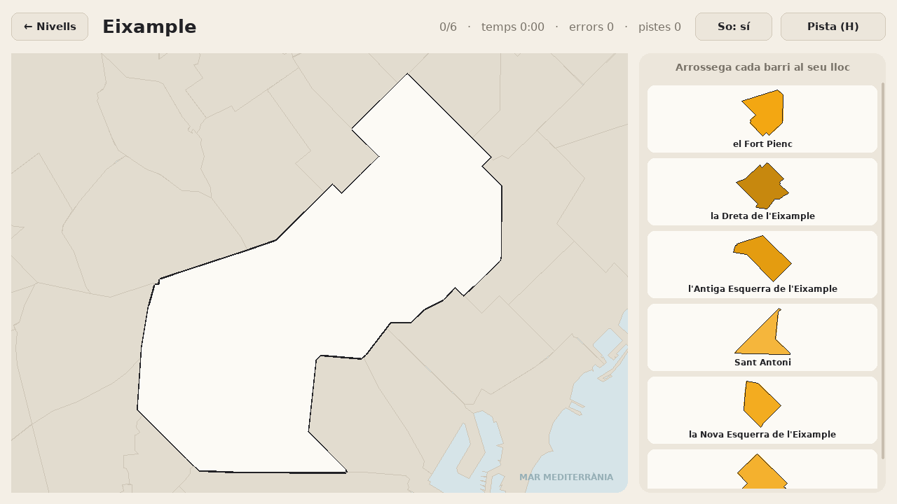
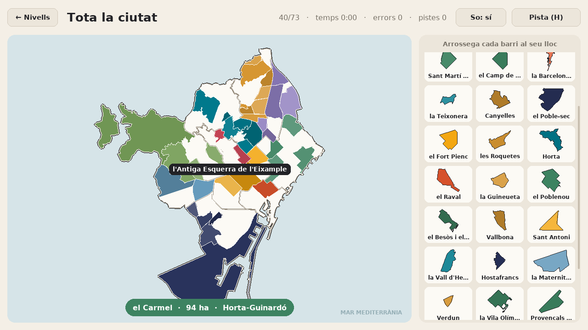
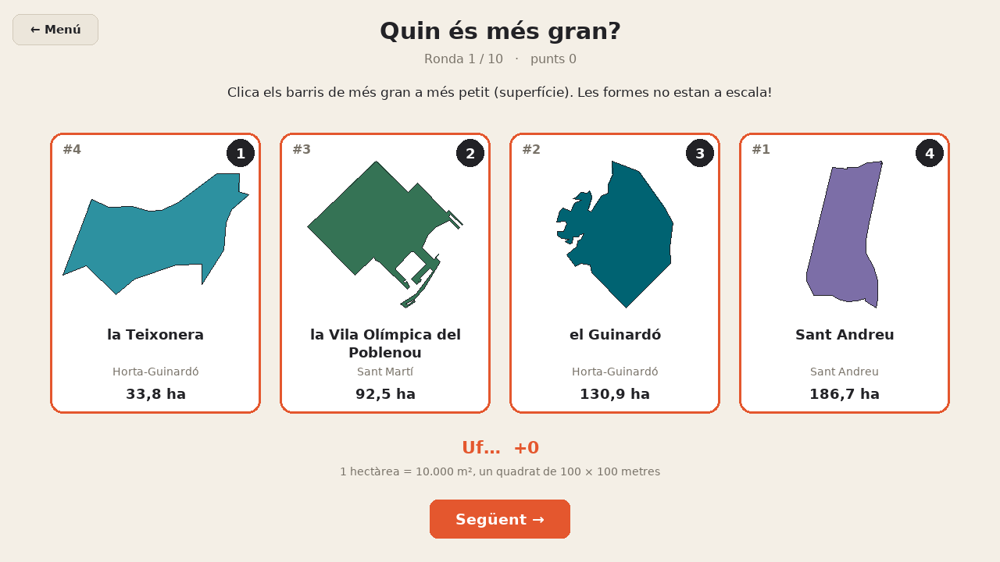

# Barri a Barri

<p align="center"></p>

**El trencaclosques de Barcelona.** Encaixa els 73 barris de Barcelona al mapa, districte a districte, i endevina quins són més grans. Fet amb dades obertes.

<p align="center"></p>

- **Mapa:** 10 nivells (un per districte) i el repte final amb tota la ciutat.
- **Dades:** quin és més gran? Ordena quatre barris per superfície.

## Captures

| Districte a districte | Tota la ciutat | Quin és més gran? |
|---|---|---|
|  |  |  |

## Jugar

- **Al navegador, sense instal·lar res:** [lluis-ridao.github.io/barri-a-barri](https://lluis-ridao.github.io/barri-a-barri/)
- **Descàrrega per a Linux i Windows:** [última versió](https://github.com/lluis-ridao/barri-a-barri/releases/latest)

Linux: descomprimeix i executa `./instalar.sh` (o `sudo ./instalar.sh` per a tots els usuaris).

## Executar des del codi

```bash
pip install pygame-ce
python game.py
```

## Compilar

GitHub Actions compila Linux, Windows i la versió web a cada `push` a `main` (artefactes de l'execució). Si poses una etiqueta `v*` (per exemple `v0.1.0`), també crea una *Release* amb els tres zips.

## Crèdits

- Joc: Lluís Ridao — [lluisridao.com](https://lluisridao.com)
- Dades cartogràfiques: Ajuntament de Barcelona / CartoBCN (CC BY 4.0), via [martgnz/bcn-geodata](https://github.com/martgnz/bcn-geodata)
- Tipografia: DejaVu Sans
- Fet amb Python i [pygame-ce](https://pyga.me/)
